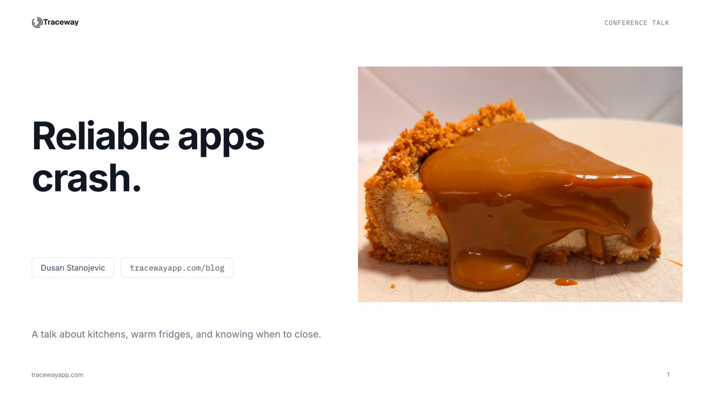

# Reliable apps crash

**Game of Codes 2026** · Niš, Serbia · October 9, 2026

[Slides (PDF)](slides.pdf) · [Write-up and code](https://tracewayapp.com/blog) · [Event](https://gameofcodes.rs/)

## About

A talk about kitchens, warm fridges, and knowing when to close.

When a request fails halfway through, the framework catches it, logs it, returns a 500 and moves on. The process is up. The health check is green. But anything that request touched in memory stays exactly as the failure left it. Caches, counters, maps. Every request after that inherits the mess.

We look at a tiny Go cache that ends up reporting two keys while storing one, and two ways out. Remove the state that can break, or stop the process and let a supervisor bring it back from a clean slate. The examples are in Go and Java, but the idea applies to any long-running service.

## What it covers

1. **Invariants and side effects.** The rules your state must follow, and what a failure leaves behind.
2. **The bug.** An in-memory cache that lies while the server keeps smiling.
3. **Two fixes.** Store less state, or crash and restart.
4. **Boundaries.** Choosing where to recover, from a single operation up to the whole process.
5. **Supervisors.** Restarts, backoff and readiness checks, plus a war story about a restart that never came.

## Three lines to take home

1. Recover at the narrowest boundary that can establish valid state.
2. Otherwise, stop the component. Restart only through a trusted recovery path.
3. Then go read the panic. The crash was the easy part.

---

[← All talks](../)
