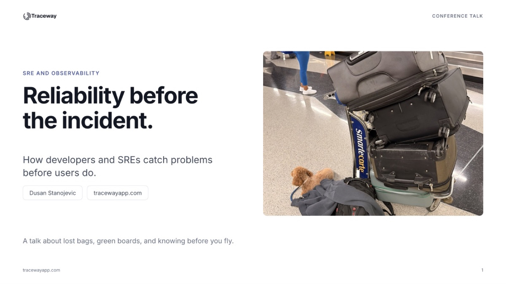

# Reliability before the incident

**SREday Dallas 2026** · Dallas, Texas · October 23, 2026

[Slides (PDF)](slides.pdf) · [Event](https://sreday.com/2026-dallas-q4/)

Listed in the program as *From Firefighting to Foresight: Observability Is Reactive by Default, and It Shouldn't Be*.

## About

A talk about lost bags, green boards, and knowing before you fly.

Someone clicks "reset password". The API writes a row, says "check your inbox", and the process dies before the email job is queued. Pods are healthy. Latency is great. The queue is empty. The sender has no errors. Every graph is green, and a person is locked out at 2 am.

Available is not reliable. Most observability is reactive by default. We find out from a customer, a ticket or a page. This talk argues that it doesn't have to be that way. We take one password reset workflow, name its promise, make it observable, break it on purpose before release, and decide who finds out first when it fails.

## What it covers

1. **Available is not reliable.** A service can answer every request and still break its promise.
2. **The default loop is backwards.** Reactive and proactive teams use the same data. The difference is when they do the work.
3. **Name the promise.** "99.9% of password resets are delivered within 60 seconds", and the checks that follow from it.
4. **Make it observable.** One row per reset, a checker, the metrics, and one scan that accounts for every reset.
5. **Break it before release.** Lose twenty resets on purpose and walk the failure matrix.
6. **Tighten the loop.** Monitors, exception tracking, burn-rate alerts, and whether on call has time to act.
7. **One contract, both teams.** Developers and SREs define the promise together, with the feature, not after the incident.

## The line to take home

Before we deploy the feature, we should be able to explain how we will know it is keeping its promise, and who finds out first when it is not.

---

[← All talks](../)
